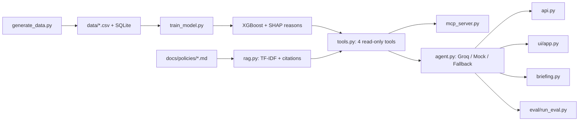

# Clinic Pulse

A small, working prototype of an AI assistant for animal-health sales reps. It predicts which veterinary clinics may reduce orders in the next 90 days, explains why using SHAP, answers policy questions with citations, and writes a weekly briefing per rep.

**Everything is synthetic.** No real company, customer, or personal data is used. The UI shows a `Demo uses synthetic data.` banner. All tools are read-only: the system never applies discounts, no matter what the model predicts. A human decides.

## Architecture



Data flow: generation and training are offline batch steps. Every other component reads the same files in `data/`. The agent only answers from tool results.

## Quick start (clean checkout, Windows PowerShell)

Requires Python 3.11 or newer. The commands below use the installed `py` launcher.

```powershell
cd clinic-pulse
py -3.11 -m venv .venv
.\.venv\Scripts\python.exe -m pip install -r requirements.txt
.\.venv\Scripts\python.exe src/generate_data.py
.\.venv\Scripts\python.exe src/train_model.py
.\.venv\Scripts\python.exe -m pytest -q
.\.venv\Scripts\python.exe eval/run_eval.py
```

On macOS/Linux, replace `py -3.11` with `python3.11` and use `.venv/bin/python`.

Expected final output from the eval: `Mock score: 14/14`, and from pytest: `6 passed`.

The repository already contains generated data, so the UI also works immediately after install. Regenerating data changes the sample only if the generator or seed changes.

## Model result

Time-aware split: train on snapshots from month 8, test on month 9.

| Metric | XGBoost | Rule baseline (value down >15% over 3 months) |
| --- | --- | --- |
| Precision | 0.861 | 0.984 |
| Recall | 1.000 | 1.000 |
| ROC-AUC | 1.000 | n/a |

**Honest note:** the rule baseline has higher precision on this synthetic test set. The XGBoost model has perfect ranking (ROC-AUC 1.000) and perfect recall, but its default 0.5 threshold yields more false positives. This is expected because the synthetic decline pattern is deliberately simple. Tuning the threshold, or making the synthetic data noisier, would change the comparison. No claim is made that the model beats the rule here.

## Running the pieces

### REST API

```powershell
.\.venv\Scripts\python.exe -m uvicorn src.api:app --reload --port 8000
```

Endpoints:

- `GET /health`
- `GET /clinics/at-risk?rep_id=REP-01&top_n=10`
- `GET /clinics/C-017`
- `POST /ask` with body `{"question": "Why is clinic C-017 flagged?", "rep_id": "REP-01"}`

Quick check from another terminal:

```powershell
Invoke-RestMethod http://localhost:8000/health
```

### MCP server

The server exposes `get_at_risk_clinics`, `get_clinic_history`, `explain_risk`, and `search_policy` over stdio.

```powershell
.\.venv\Scripts\python.exe src/mcp_server.py
```

To inspect it with the MCP Inspector (needs Node/npm and internet the first time):

```powershell
npx @modelcontextprotocol/inspector .\.venv\Scripts\python.exe src/mcp_server.py
```

### Streamlit UI

```powershell
.\.venv\Scripts\streamlit.exe run ui/app.py
```

Open the local URL printed in the terminal. Use the rep selector, ask a question, and expand **Tools used and citations** to see the tool calls and policy sources. Thumbs up/down ratings are appended to `data/feedback.jsonl`.

### Weekly briefing

```powershell
.\.venv\Scripts\python.exe src/briefing.py --rep-id REP-01
```

Output is written to `data/briefings/REP-01.md`. The command is cron-friendly; pass `--top` to change the number of clinics.

### Evaluation

```powershell
.\.venv\Scripts\python.exe eval/run_eval.py
```

`eval/questions.json` has 14 cases, including three that must be refused. The script always runs mock mode and additionally runs Groq mode when `GROQ_API_KEY` is set.

## Groq configuration

Copy the example file and fill in your key:

```powershell
Copy-Item .env.example .env
```

```dotenv
GROQ_API_KEY=your-key-here
GROQ_MODEL=openai/gpt-oss-120b
```

`.env` is git-ignored; never commit a key. The default model is `openai/gpt-oss-120b`. The originally requested `llama-3.3-70b-versatile` was deprecated and shut down on 2026-08-16 according to Groq's changelog, so it was replaced with a currently supported tool-calling model. Change `GROQ_MODEL` to any other tool-capable Groq model ID.

### Modes

- **Mock** — no `GROQ_API_KEY`: a keyword router calls the same tools and formats answers with citations. Fully offline.
- **Groq** — key present: the Groq SDK runs a tool-calling loop with temperature 0.1 and at most four iterations. The system prompt requires answers from tool results only, policy citations by file and section, refusals when evidence is missing, no invented numbers, no automatic actions, and short answers.
- **Fallback** — any Groq timeout, HTTP 429, or API error is retried once after a one-second delay; if it still fails, the agent switches to the mock router and returns mode `Fallback`. If the model issues tool calls for all four iterations without a final answer, the agent builds the answer from the tool results already collected and also reports mode `Fallback`. The UI displays the active mode.

Every tool call is logged with name, arguments, and a UTC timestamp, and returned in `tool_calls` for display in the UI.

## Limitations

- All data, policies, clinic names, and figures are synthetic. No real clinic or personal data exists here.
- The mock router is keyword-based, not a real language model. It handles the demo questions but not arbitrary phrasing.
- The XGBoost model is trained on 300 synthetic clinics; the baseline comparison is documented above.
- TF-IDF finds word overlap, not meaning. The `SCORE_THRESHOLD = 0.12` in `src/rag.py` is a simple refusal guard.
- Groq mode needs network access and a valid key; mock mode does not.
- There is no authentication, role-based access, or audit log beyond local feedback.

## Next steps for production

- Move data pipelines and model training to Databricks jobs with Unity Catalog.
- Track experiments, model versions, and approvals in MLflow.
- Replace direct CSV reads with a Spring Boot data service exposing authorised endpoints.
- Add role-based access control and per-rep data isolation.
- Add monitoring for drift, latency, refusal rate, tool errors, and feedback trends.
- Add CI/CD for lint, tests, model validation, and controlled deployment.
- Replace TF-IDF with evaluated retrieval and a human-reviewed policy corpus.

## 3-minute demo script

1. **Start the UI:** `.\.venv\Scripts\streamlit.exe run ui/app.py`. Point at the banner and the **Active mode: Mock** label.
2. **Ask:** `Which clinics are most at risk?` — show the ranked table and the reasons. Expand **Tools used and citations** to show `get_at_risk_clinics` and its timestamp.
3. **Ask:** `Why is clinic C-017 flagged?` — show the SHAP reasons and risk score.
4. **Ask:** `What can I offer clinic C-017?` — show the `targeted_promotions.md` / `Allowed Offers` citation and the explicit note that a human manager decides.
5. **Ask:** `What is the weather forecast tomorrow?` — show the refusal.
6. **Optional:** show `data/briefings/REP-01.md` and say it is generated by one scheduled command.
7. **Optional:** add `GROQ_API_KEY` to `.env`, restart the UI, and show **Active mode: Groq** (or **Fallback** if the API fails).

## Ten interview questions

1. How do you guarantee there is no leakage between features and the 90-day label?
2. Why use a time-aware split instead of a random split here?
3. What does SHAP contribute, and why show three reasons instead of one?
4. The rule baseline has better precision. Why would you still keep the model?
5. How does `tools.py` act as a boundary between data, MCP, API, and agent?
6. What happens if a Groq call times out or returns 429?
7. Why TF-IDF instead of embeddings for the policy documents?
8. How does the RAG layer decide to refuse instead of guessing?
9. How would you add role-based access without changing the read-only tool contracts?
10. Which parts of this prototype must change before it could touch real clinic data?
